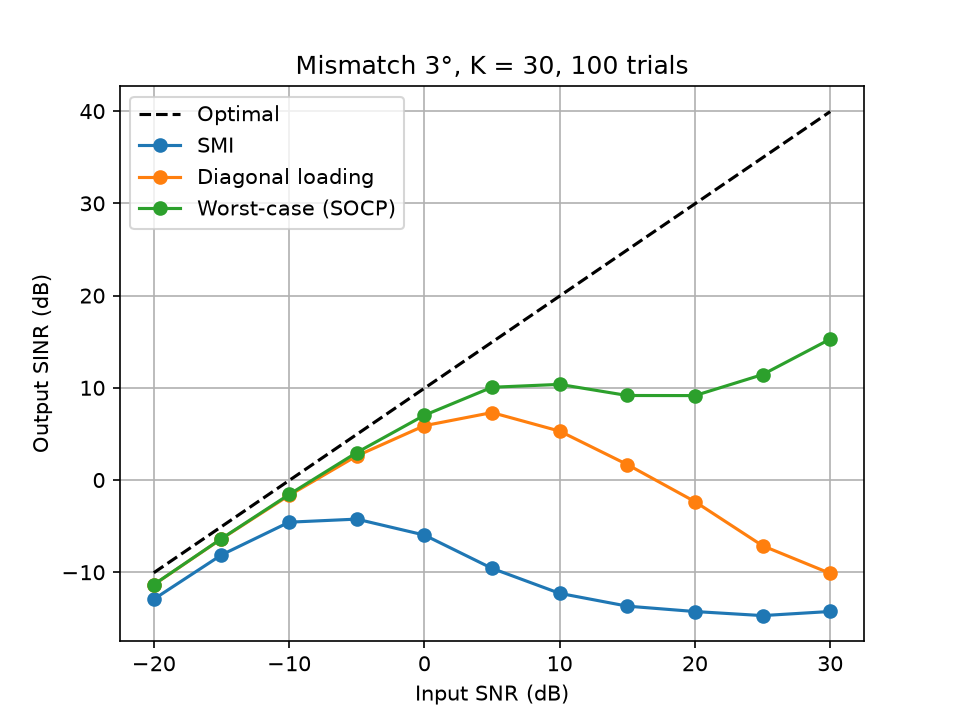

# Worst Case Robust Beamforming

This small simulation studies what happens when an adaptive array aims in a slightly wrong direction. It compares a sample-matrix inversion (SMI) beamformer, a diagonally loaded variant, and a worst-case beamformer built as a second-order cone program (SOCP). An ideal curve with the true steering vector and known interference-plus-noise covariance is shown as a benchmark.

The experiment adapts the look-direction mismatch example in Vorobyov, Gershman and Luo (2003). See the [reference and experiment scope](docs/REFERENCE.md) and [plot and interpretation](docs/RESULTS.md).



## Run the simulations

Use Python 3.11 or newer. From the directory containing this README:

```bash
python -m venv .venv
source .venv/bin/activate          # macOS / Linux
# On Windows Git Bash, use: source .venv/Scripts/activate
python -m pip install -r requirements.txt
python sim.py
python plateau_sweep.py
```

- [`sim.py`](sim.py) prints output SINR and regenerates `figs/sinr_vs_snr.png`. It uses a 10-element half-wavelength array, 30 training snapshots, 100 trials per SNR, 30 dB interferers at 30° and 50°, and a **2° presumed / 5° actual** desired direction.
- [`plateau_sweep.py`](plateau_sweep.py) prints a table using **3° presumed / 5° actual**. It varies the snapshot count and the uncertainty radius, including an exact covariance benchmark. The many SOCP solves may take a few minutes.
- Both scripts use a seeded random generator. Solver and plotting versions can change the last digits or appearance. The archived plot is included so you can inspect the result without running the solver.

The staged Git import uses reconstructed dates for organization. It does not recreate original Git activity.
