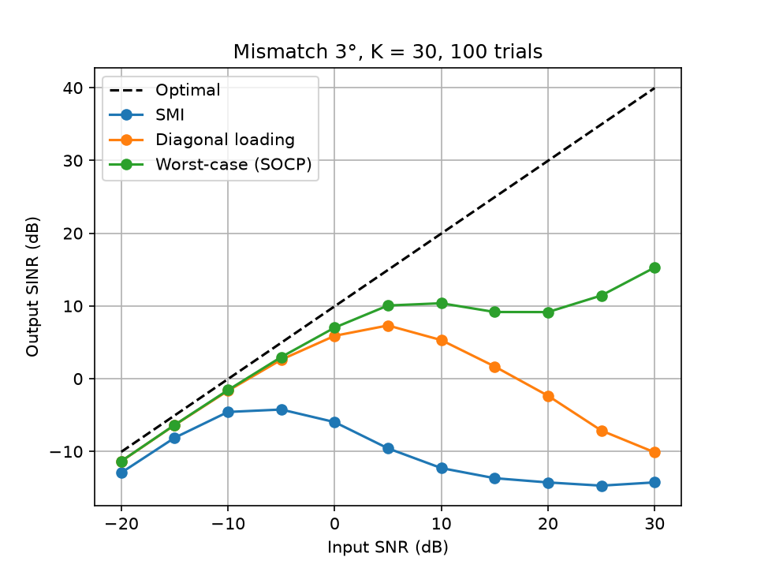

# Beamforming result

The horizontal axis is the desired signal's input SNR. The vertical axis is the output signal-to-interference-plus-noise ratio after applying the array weights. A higher curve means better separation of the desired signal from interference and noise in this particular simulation. The dashed reference uses the actual steering vector and known interference-plus-noise covariance.

In the archived 3° mismatch plot, the worst-case design generally leads SMI and diagonal loading. The gap is most visible at higher input SNR. It still falls short of the ideal reference: enforcing a robust response around an uncertain steering direction is different from knowing the direction exactly.

[The plateau sweep](../plateau_sweep.py) isolates three choices: finite-sample covariance, exact covariance, and uncertainty radius. It prints results for 30, 100, 300 and exact covariance with radii 2.0, 3.0 and 3.1. Its presumed direction is 3°, so do not interpret its printed values as extra points on the 2°-presumed main figure.
